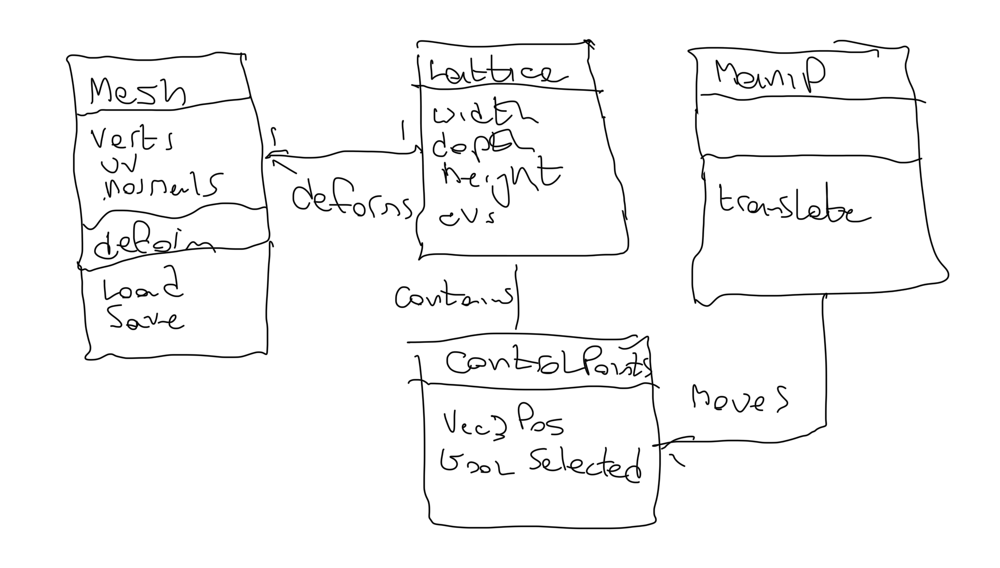
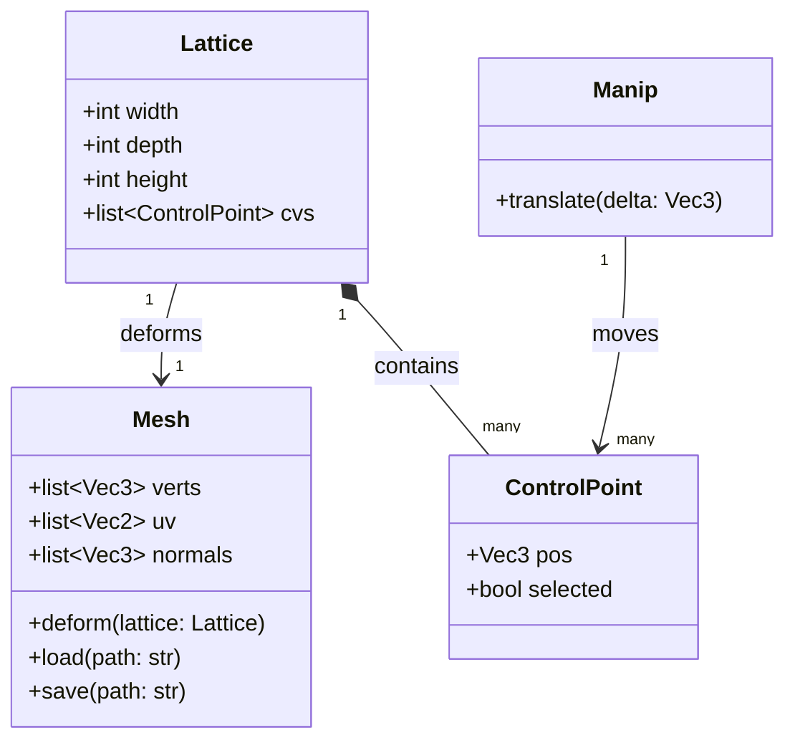

# Jon Macey ASE Assignment

## Introduction

For this project I am going to develop a simple Free Form Deformation demo using PySide6, Numpy and PyNGL. It will start by implementing the original Sederberg and Parry FFD paper. https://people.eecs.berkeley.edu/~sequin/CS285/PAPERS/Sederberg_Parry.pdf the I may look at some of the later improvements.

## Inital Design

For the basic setup I will use some of the existing PyNGL demos to get started. Initially I will need to load a mesh (I will use Obj to get started) and then develop a simple grid overlay to allow the user to select control points.

After that I will need to implement the FFD algorithm itself using the Bernstein polynomial basis functions (using numpy for speed).



## A better class diagram.

It is possible to use [mermaid](https://mermaid.js.org/) to create better class diagrams and render them in GitHub Markdown. The following mermaid code can be used to render the class diagram (we use the triple quotes ````mermaid` to denote the start and end of the code block and github will render to a diagram). If you open this file in the editor you can see the raw mermaid code.



This is still the initial design and will change as I progress, but this is the first thing you should do when starting the project.
